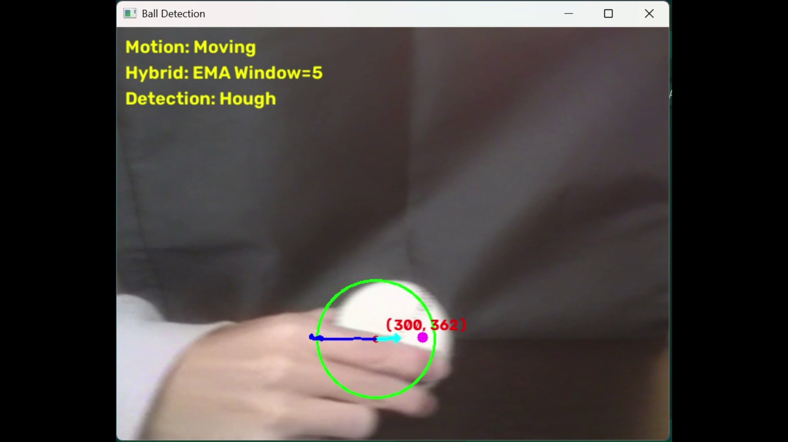

# Baseball Tracker — リアルタイム野球ボール追跡・位置予測

[](https://github.com/2114-takumi/ball-tracker/actions/workflows/python-ci.yml)

## Overview

PythonとOpenCVを使い、Webカメラに映った野球ボールの位置・移動軌跡・速度を推定し、**0.2秒後の位置**を予測する学習プロジェクトです。

指による部分的な遮蔽でContour（輪郭）検出が失敗する問題に対し、前回の追跡位置付近で円を探すHough Circleを補助検出として導入しました。

検出中心の揺れをEMA（指数移動平均）で平滑化し、運動状態に応じてRaw（生の検出座標）とEMAを切り替えるHybrid方式を実装しました。0.2秒後の予測点を画面に表示するとともに、各方式の予測誤差を同じ検出中心を基準に定量評価し、ノイズ低減と応答遅れの関係を検証しています。

## Demo



**[デモ動画を見る（MP4）](assets/demo.mp4)** — GitHub上で再生できない場合は、動画をダウンロードして確認できます。

約32秒のデモです。カメラを固定し、次の順序で検出方法・運動状態・予測方式の切り替えを示します。

1. ボールのみを追跡し、`Detection: Contour` を表示
2. 親指をボールに付け、Hough Circleによる補助検出へ切り替え
3. ボールを左右に動かし、`Moving` / `Turning` を表示
4. HybridのEMA / Raw切り替えと、0.2秒後の予測点を表示
5. 親指を離し、Contour検出へ復帰

動画は動作例です。以下の実験結果はそれぞれ別の評価試行で得たもので、新しいデモ動画の集計値ではありません。

### 画面の見方

通常は `Ball Detection` ウィンドウだけを表示します。

| 表示 | 意味 |
| --- | --- |
| 緑色の外接円・赤色の中心点 | EMAで平滑化した中心を使用。円の半径は採用した検出値 |
| 青色の移動軌跡 | EMA後の中心座標を最大30点表示 |
| 水色の速度ベクトル | Hybridが選んだ方式の速度を、0.1秒分の長さで表示 |
| 紫色の予測点 | Hybridによる0.2秒後の予測位置 |
| `Motion: ...` | `Stationary` / `Moving` / `Turning`。履歴不足時は `Measuring`、未検出時は `Not detected` |
| `Detection: ...` | 採用した検出方法：`Contour` / `Hough` / `Not detected` |
| `Hybrid: EMA Window=5` / `Hybrid: Raw Window=5` | 現在の予測に使用した方式 |

Stationary / MovingではEMA Window=5、TurningではRaw Window=5を使用します。EMA選択時の矢印は平滑化した中心、Raw選択時は生の検出中心を起点とするため、Turning時には赤い中心点と矢印の始点がずれる場合があります。速度履歴が不足している間や未検出時には、矢印・予測点・Hybridラベルを表示しません。

## Key Results

| Metric | Result |
| --- | ---: |
| 通常動作時の処理速度 | 約30 FPS |
| ボールのみ・静止時の検出フレーム率 | 100.00%（579/579） |
| 親指あり・静止時の検出フレーム率 | 100.00%（919/919） |
| 親指あり・静止時のHough使用率 | 98.04% |
| 静止・移動を含むHybrid評価試行の検出フレーム率 | 99.47%（2452/2465） |
| Hybrid評価試行のRaw Window=5平均予測誤差 | 17.36 px |
| 同試行のEMA Window=5平均予測誤差 | 12.21 px |
| 同試行のHybrid平均予測誤差 | **11.98 px** |

> 数値は限定された撮影条件での各実験結果です。
> 検出フレーム率はプログラムがボール候補を採用した割合であり、正解ラベルに基づく検出精度ではありません。
> 位置予測誤差は後続フレームの検出中心を基準としており、真のボール中心との誤差ではありません。

## Processing Pipeline

```text
Camera
  -> HSV mask -> Opening -> Closing
  -> Contour detection + candidate selection
       |-- Selected -----------------------------------+
       |-- Not selected + previous tracking available  |
       |     -> Hough Circle in ROI -> candidate check -+
       |                                               |
       |                                      Selected ball
       |                                               |
       |                         Tracking update + EMA smoothing
       |                                               |
       |                               Motion classification
       |                                               |
       |                         +---------------------+------------------+
       |                         |                                        |
       |                  Raw velocity                              EMA velocity
       |                         |                                        |
       |                  Raw prediction                            EMA prediction
       |                         +---------------------+------------------+
       |                                               |
       |                               Hybrid selection (Window=5)
       |                               Turning: Raw / Otherwise: EMA
       |                                               |
       |                                  Display + prediction evaluation
       |
       +-- No candidate -> Not detected / clear pending predictions
```

Hough Circleは輪郭から追跡対象を選べず、前回の追跡位置が残っている場合だけ実行します。前回中心から40 px以内・半径差15 px以内の円のうち、最も近い円を採用します。初回検出はContourが必要で、5フレーム連続で未検出になると追跡位置・半径・平滑化状態をリセットします。検出が途切れた時点で速度履歴と未評価の予測を消去し、履歴が再びそろってから予測を再開します。

## Quick Start

Windows / PowerShellを想定しています。Python 3（`venv`・`pip`が利用可能な環境）、Webカメラ、GUI表示が可能なデスクトップ環境が必要です。CIの構文チェックにはPython 3.13を使用しています。依存パッケージは [requirements.txt](requirements.txt) に記載した `opencv-python`（OpenCV）と `numpy` です。

リポジトリのフォルダ内で実行してください。

```powershell
python -m venv .venv
.\.venv\Scripts\python.exe -m pip install -r requirements.txt
.\.venv\Scripts\python.exe main.py
```

既存の `.venv` が別のPCや削除済みのPythonを参照している場合は、その環境を再利用せず、利用可能なPythonから仮想環境を作り直してください。依存パッケージのバージョンは固定していないため、インストール時期によって環境が変わる可能性があります。CIの成功はカメラでの動作や実験数値の再現を保証するものではありません。

既定のカメラ（`cv2.VideoCapture(0)`）を使用します。カメラの使用を許可し、白いボールを画面内に映してください。表示ウィンドウで **`q` キー**を押すと終了し、予測誤差・検出フレーム数の集計結果がターミナルに表示されます。

現在の候補選別は画像上の外接円半径 **50〜100 px** を前提としています。ボールが小さすぎる・大きすぎる場合はカメラとの距離を調整してください。カメラが起動しない場合は、OSのカメラ権限や他アプリによる使用を確認してください。`assets/demo.mp4`は閲覧用で、現在のコードに動画ファイル入力の機能はありません。

### カメラ不要の品質確認

```powershell
.\.venv\Scripts\python.exe -m compileall -q main.py
```

[Python CI](.github/workflows/python-ci.yml)でも、Windows / Python 3.13で依存パッケージのインストールと同じ構文チェックを行います。`main.py`はimport時にカメラを起動するため、CIでは実行・importせず、カメラやGUIの動作は検証しません。

## Main Features

- **ボール検出**：HSV色空間で白色領域を抽出し、Opening・Closingを適用。輪郭面積・外接円半径・円形度・外接円に対する面積比を使って候補を選別
- **追跡**：前フレームの検出位置との距離を使って、追跡対象が別の白い物体へ切り替わることを抑制
- **可視化**：ボールの中心・外接円、直近の移動軌跡、速度ベクトル、予測位置をカメラ映像に表示
- **未来位置予測**：画像上の速度（px/s）を求め、等速運動を仮定して0.2秒後の位置を推定
- **性能比較**：瞬間速度（Window=1）と5回・10回の移動平均を、同じ映像・同じ時刻で評価
- **運動状態判定**：静止（Stationary）・移動（Moving）・左右方向転換（Turning）を簡易判定
- **初期方式のAdaptive評価**：Rawの通常時Window=5・方向転換時Window=1という比較方式も保持。現在の画面表示に使うHybridとは別方式
- **定量評価**：予測位置と後続フレームの検出位置との差、および検出フレームの割合を出力
- **遮蔽への対応**：輪郭検出でボールを選べない場合、直前の追跡位置付近でHough Circleを使って補助検出
- **EMAによる座標平滑化**：検出中心の揺れを低減し、描画・軌跡・運動状態判定を安定化。平滑化後の座標による速度推定も比較評価
- **Hybrid位置予測**：Stationary・MovingではEMA、TurningではRawのWindow=5を選択。速度ベクトルと0.2秒後の予測点を表示し、Raw・EMA単独との誤差も比較

## Evaluation

### Evaluation Method（評価方法）

**検出フレーム率 = ボール候補を採用したフレーム数 ÷ カメラから取得できた全フレーム数 × 100** と定義します。ContourまたはHoughが候補を採用した割合であり、正解ラベルに基づく物体検出精度ではありません。誤検出率や真のボール中心との位置誤差は未評価で、以下の数値は限定された撮影条件での結果です。

速度履歴が10回分そろってからWindow=1・5・10の予測を同じ時刻に生成します。各予測について、約0.2秒後に取得できた最初のフレームの検出中心と予測中心のピクセル距離を計算しています。Adaptiveは予測時の運動状態に応じて、方向転換時はWindow=1、それ以外はWindow=5の誤差を集計します。

改良後のEMA・Hybridも同じ予測開始条件で生成し、Rawと同じ平滑化前の検出中心で評価します。運動状態別の分類には、評価時ではなく予測作成時の状態を使います。未検出になった場合の未評価予測や、終了時にまだ評価時刻へ達していない予測は集計しません。方式ごとの予測数も出力して、比較対象の件数を確認します。

### Occlusion Robustness（遮蔽への対応）

手や指が白い野球ボールに触れると、輪郭が変形して通常のContour検出が失敗する問題が発生した。

そこで、通常はHSVによる白色抽出と輪郭検出を使用し、輪郭から追跡対象を選べない場合に、前回の追跡位置付近でHough Circleを実行する補助検出を追加した。

| 実験条件 | 検出フレーム数 | 検出フレーム率 | Hough使用率 |
| --- | ---: | ---: | ---: |
| A：ボールのみ・静止 | 579/579 | 100.00% | 0.00% |
| B：親指あり・静止 | 919/919 | 100.00% | 98.04% |
| C：親指あり・左右移動 | 827/827 | 100.00% | 94.20% |

親指ありの実験B・Cには、親指を付ける前の追跡開始区間も含まれます。表は各試行全体の集計であり、親指の接触中だけを切り出した評価ではありません。Hough使用率は取得フレーム全体に占めるHough採用フレームの割合です。

これらの試行では、親指が接触した状態でもHough Circleによる補助検出を利用して追跡を継続できた。

ただし、これは検出候補の採用率であり、真のボール中心との位置誤差や誤検出率は評価していない。

### EMA-based Velocity Estimation

Hough Circleで推定した中心座標にはフレームごとの揺れがあり、静止しているボールでも大きな瞬間速度が計算される場合があった。

そこで、指数移動平均（EMA）で平滑化した座標から速度を計算する方式を追加し、従来のRaw方式と比較した。

EMAの係数は alpha=0.25、速度の移動平均はWindow=5、予測時間は0.2秒とした。

| 実験条件 | Raw Window=5 | EMA Window=5 |
| --- | ---: | ---: |
| A：ボールのみ・静止 | 1.04 px | **0.93 px** |
| B：親指あり・静止 | 9.63 px | **2.87 px** |
| C：親指あり・左右移動 | **13.95 px** | 17.58 px |

静止時、とくに親指による遮蔽がある条件ではEMAによって予測誤差が減少した。

一方、移動時にはEMAの応答遅れによって誤差が増加する試行も確認された。

### Hybrid Prediction

運動状態に応じてRawとEMAを切り替えるHybrid方式を実装した。

- Stationary / Moving：EMA Window=5
- Turning：Raw Window=5

静止・移動・方向転換を含む別の評価試行では、次の結果を得た。

| 方式 | 平均予測誤差 |
| --- | ---: |
| Raw Window=5 | 17.36 px |
| EMA Window=5 | 12.21 px |
| **Hybrid** | **11.98 px** |

3方式とも2,277回の予測を評価した。

Hybridは同試行でEMA単独と比較して平均予測誤差を約1.95%削減した（実験時の集計結果。表の平均誤差は小数第2位までの表示値）。

Turning時には42回Rawを選択し、それ以外の2,235回ではEMAを使用した。

ただし、これは限定された撮影条件での結果であり、Hybridが常に最小誤差になることを示すものではない。改善幅は小さく、運動状態による切り替え規則は事前の実験結果を参考に設計している。異なる条件・複数の独立した試行での再検証が必要である。

現在はHybrid方式を比較評価と画面表示の両方に使用する。描画仕様は「画面の見方」を参照。Raw・EMA・Hybridの平均予測誤差と予測数、Hybridの方式別使用回数は、プログラム終了時にターミナルへ出力する。

### Initial Baseline（初期方式の評価）

以下はHough Circle、EMAベースの速度推定、Hybrid予測を導入する前の初期評価結果である。前述の改良後の実験とは撮影条件や評価試行が異なるため、数値を直接比較して改善率を算出するものではない。

#### 検出フレームの割合

ボールをカメラ内に映した一つの検証条件では、**615 / 615フレーム（100.00%）**でボールを検出したと判定されました。実験中は目視でも追跡対象を確認しました。通常動作時のフレームレートはおおむね**30 FPS**でした。

> この100%は今回の限定された撮影条件での結果です。ボールが写っていない場面や誤検出も評価できる汎用的な物体検出精度ではありません。

#### 0.2秒後の位置予測誤差

同じ試行で各手法598件の予測を評価した例：

| 方式 | 平均位置予測誤差（px） |
|---|---:|
| Window = 1（平滑化なし） | 10.03 |
| **Window = 5** | **9.27** |
| Window = 10 | 11.14 |
| Adaptive（通常5、方向転換1） | 9.34 |

この試行ではWindow=5が最小誤差でした。他の試行では、動かし方や方向転換の頻度により順位や誤差の大きさが変化しました。

## Design Decisions / What I Learned（工夫した点・学び）

1. **背景物体との区別**：最大面積の白色輪郭だけを選ぶと、白いボトルなどに追跡対象が移る問題を確認しました。ボールらしい形状と前回位置との連続性を組み合わせ、候補を絞る方式に変更しました。
2. **親指による輪郭の変形**：親指の接触でContour検出が失敗したため、円の形状を別の方法で検出するHough Circleを追加しました。前回位置・半径で候補を制限し、補助検出を追跡中の局所領域に限定しました。遮蔽を含む試行で、検出方法別の使用回数と候補の採用率を記録しました。
3. **中心座標の揺れと速度推定**：Houghの中心がフレームごとに揺れ、静止時にも大きな瞬間速度が出る問題から、EMAで座標を平滑化しました。初期のWindow=1・5・10比較に加え、RawとEMAを同じWindow=5で評価すると、EMAは静止時に有利な一方、移動時には応答遅れによって誤差が増える試行もありました。
4. **状態に応じた切り替え**：この結果を基に、Stationary / MovingではEMA、TurningではRawを使うHybridを設計しました。別の比較試行で平均予測誤差と方式別の使用回数を評価し、画面表示にも反映しました。改善を目視だけで判断せず、検出フレーム率と予測誤差で確認しつつ、切り替え規則の汎化性能は今後の検証課題として残しています。

### 開発について

画像処理とプログラミングの学習を目的として制作しました。実装には生成AIの説明・コード提案も参考にしながら、実機での動作確認、問題点の切り分け、パラメータの調整、実験・結果の分析を進めています。

## Limitations（限界）

- HSVの白色しきい値や輪郭面積・半径・円形度・許容移動距離などは手動で設定しています。面積比の下限は前回位置への近さに応じて切り替えますが、照明・背景・距離への自動適応はありません。丸い白色物体が複数あると誤追跡する可能性があります。
- Hough補助検出は前回の追跡情報に依存するため、完全な遮蔽や大きな位置・半径の変化からの復帰を保証しません。TurningはEMA後の軌跡の左右方向の反転による簡易判定で、一般的な3次元の方向転換を認識するものではありません。
- 速度はカメラに対する画像上の速度（px/s）であり、実空間の球速ではありません。0.2秒後の予測は等速運動を仮定しているため、急な加速や方向転換への追従に限界があります。
- 予測誤差の基準は画像から検出した中心であり、真の物理位置を別の測定器で取得したわけではありません。検出失敗時の予測は評価対象から外れる場合があります。また、連続フレームからの予測は統計的に独立ではありません。
- 掲載した数値は、各条件で実施した限定的な評価試行に基づく。複数の条件や実験を比較しているが、各条件で十分な独立反復実験を行ったわけではないため、統計的な有意性や汎化性能は未検証である。
- 撮影条件や実行環境により、検出フレーム率・予測誤差・FPSは変化します。現在はライブカメラ入力のみのため、同じ映像を入力して数値を再現する仕組みはありません。

## Future Work（今後の課題）

- 異なる照明・背景・ボールまでの距離での評価
- 丸い白色物体が複数ある場合の誤追跡を減らす改良
- 同じ録画映像を使った繰り返し実験、移動・方向転換の判定精度の検証
- 正解中心座標のラベルを用いた位置誤差・誤検出の評価、およびHybridの切り替え規則を独立した試行で検証
- 等速モデル以外の予測手法との比較
